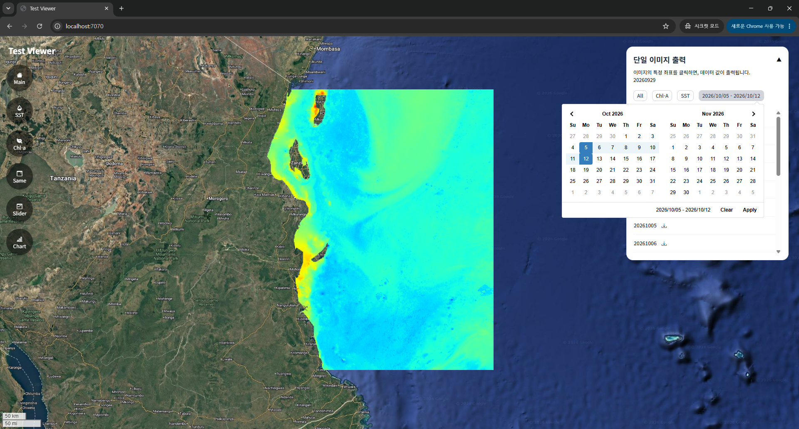
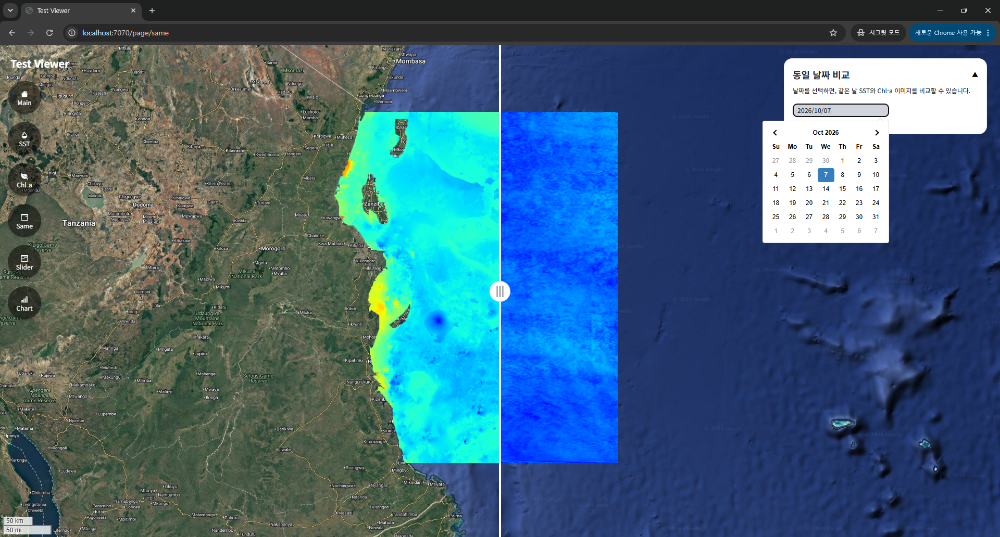
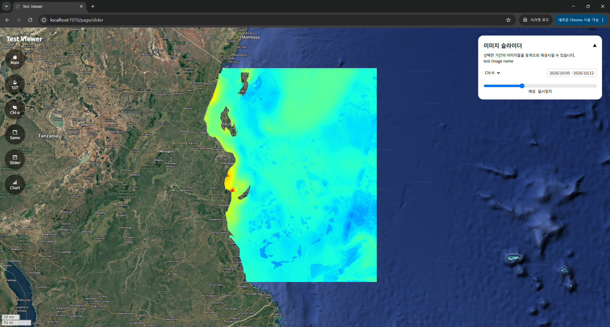
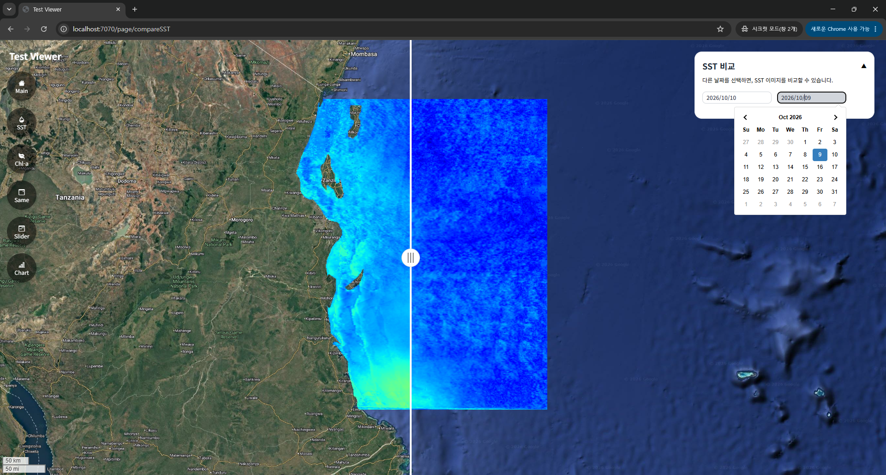

# satellite-imagery-viewer
특정 알고리즘 실행 후 생산된 최종 산출물을 지도 위에 출력해서 비교하는 웹페이지
* Javascript
* Leaflet
* Tailwindcss
* fastapi






<br>

### Init
```
nano ./src/main/resources/application.properties

작성할 내용
spring.application.name=Viewer
server.port=8000
api.url= # fastapi url
```

